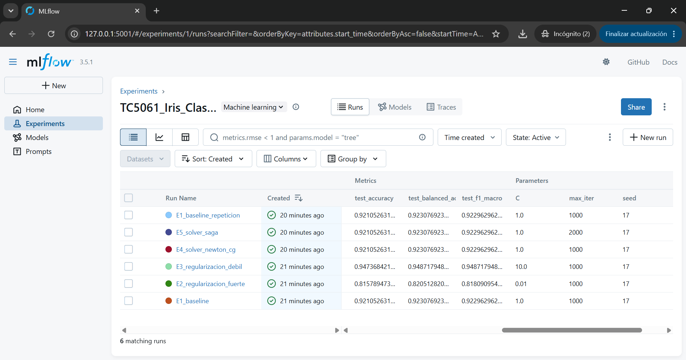
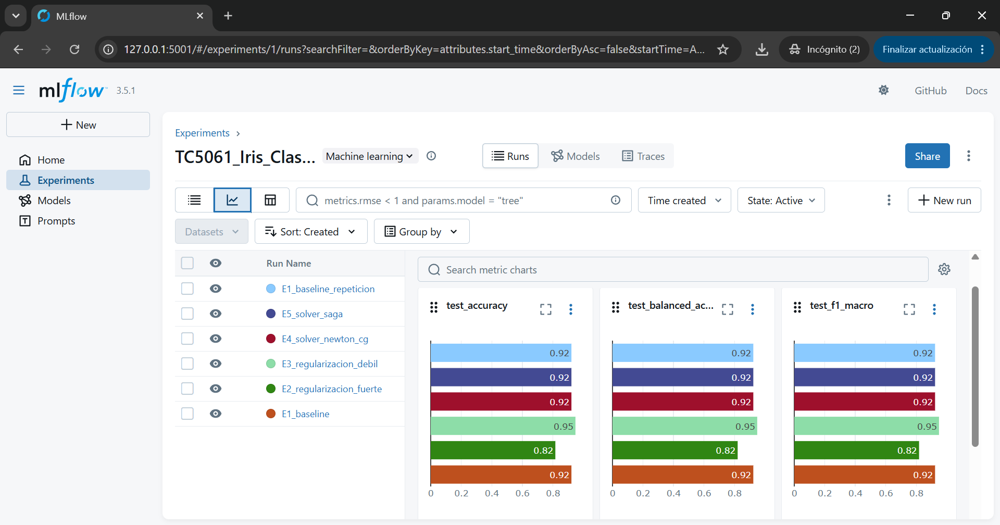
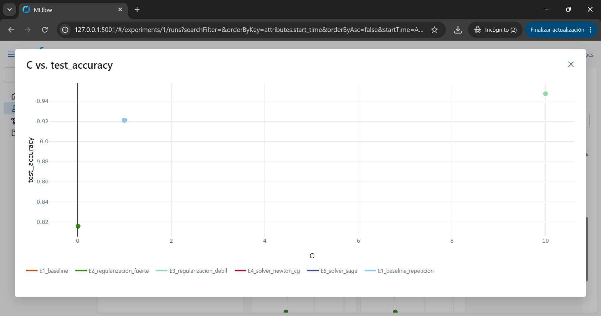
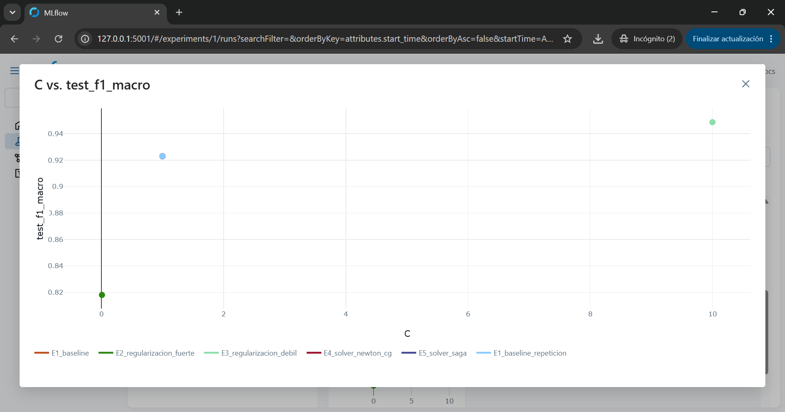
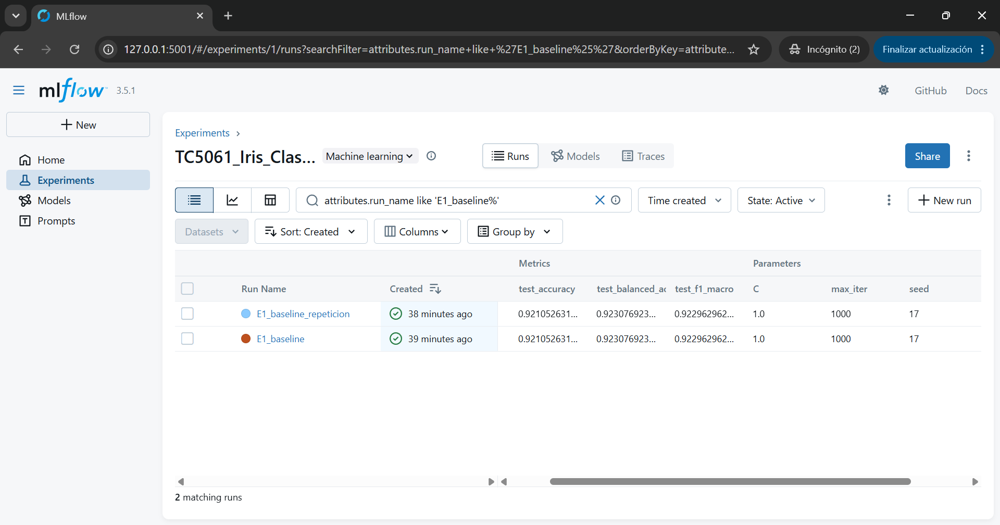
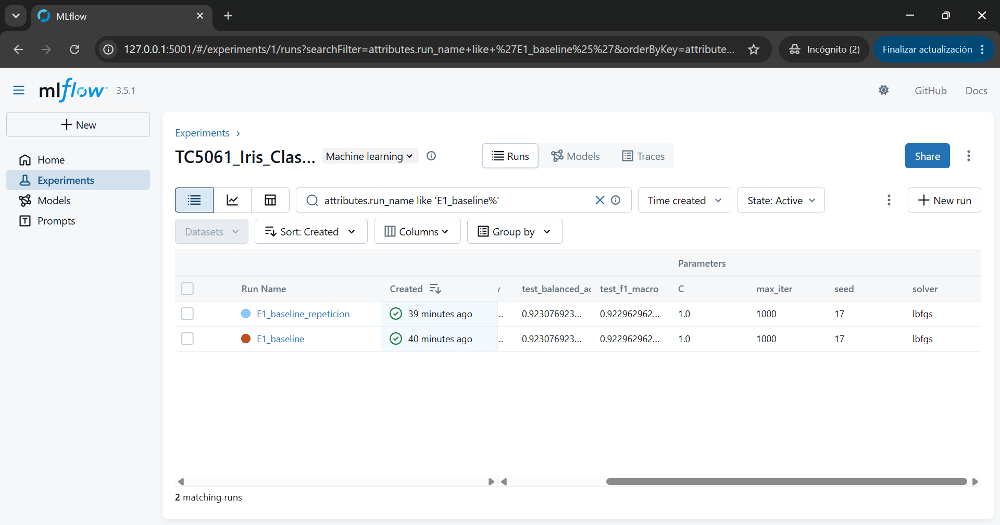
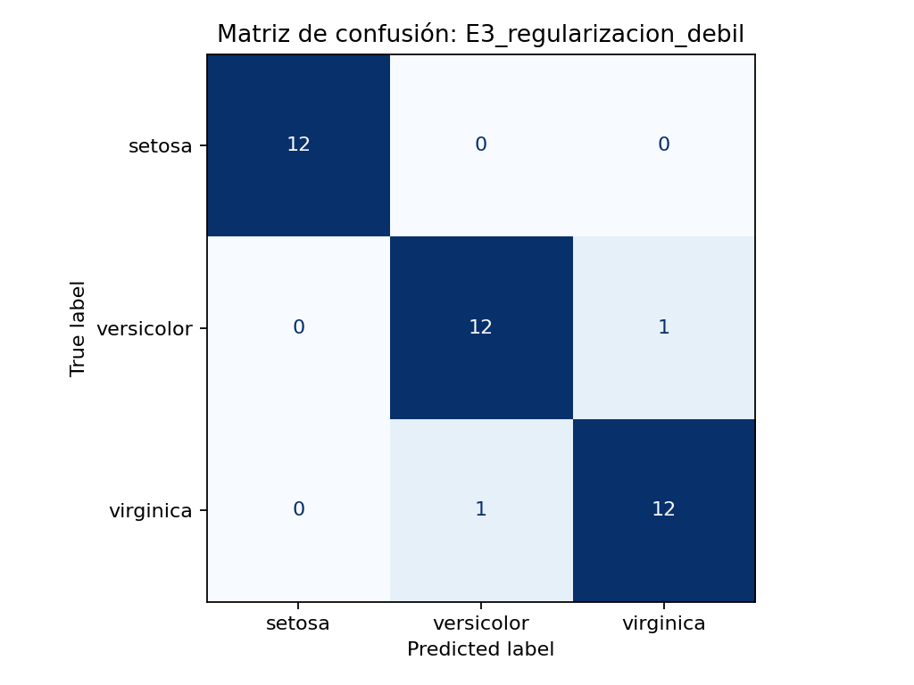
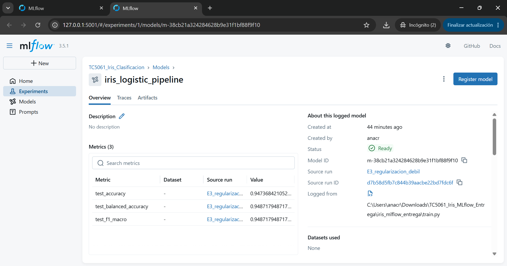

# Análisis de los experimentos Iris

Se compararon cinco configuraciones de regresión logística manteniendo la misma partición estratificada (75% entrenamiento, 25% prueba) y la semilla aleatoria 17. El mejor resultado correspondió a la configuración **E3**, con `C=10`, `solver=lbfgs` y `max_iter=1000`: obtuvo **accuracy de 0.9474** y **F1 macro de 0.9487**. En contraste, el baseline (`C=1`) alcanzó accuracy de 0.9211 y F1 macro de 0.9230. La configuración de regularización más fuerte (`C=0.01`) presentó el menor desempeño: accuracy de 0.8158 y F1 macro de 0.8181.

El hiperparámetro que mostró mayor influencia fue **C**, que regula inversamente la intensidad de la regularización. En las pruebas efectuadas, aumentar C de 0.01 a 10 mejoró sustancialmente las métricas. En cambio, los cambios de optimizador (`lbfgs`, `newton-cg` y `saga`) no alteraron el desempeño observable en esta partición; no es posible aislar el efecto del número máximo de iteraciones porque solo varió junto con el solver en E5 y no se examinó si el modelo llegó al límite.

Como limitaciones, Iris contiene solamente 150 observaciones y la evaluación se basa en una única partición de prueba de 38 flores. Una diferencia de una sola predicción correcta cambia el accuracy aproximadamente 2.63 puntos porcentuales. Entonces los resultados no bastan para garantizar que E3 será superior en otros datos o inclusive con otros splits de train y test. Creo que una posible mejora sería realizar validación cruzada estratificada y repetir el análisis sobre nuevos splits de entrenamiento y así buscar una conclusión con mayor seguridad.

Finalmente, la repetición del baseline arrojó exactamente las mismas tres métricas, lo cual respalda la reproducibilidad del flujo bajo el mismo entorno y argumentos.

## Evidencias de MLflow
Aquí se adjuntan las capturas de pantalla guardadas en la carpeta de evidencias.

### Comparación de experimentos

La siguiente tabla muestra los resultados de las seis ejecuciones, incluyendo sus métricas e hiperparámetros.

### Comparación gráfica de desempeño

### Reproducibilidad

Las dos ejecuciones del modelo base utilizaron los mismos hiperparámetros y la semilla 17, obteniendo métricas idénticas.

### Artefactos y modelo entrenado

**Declaración de IA:** ChatGPT (OpenAI, GPT-6) se utilizó como apoyo para estructurar el script, parametrizar los experimentos, debuggear y revisar el código.
